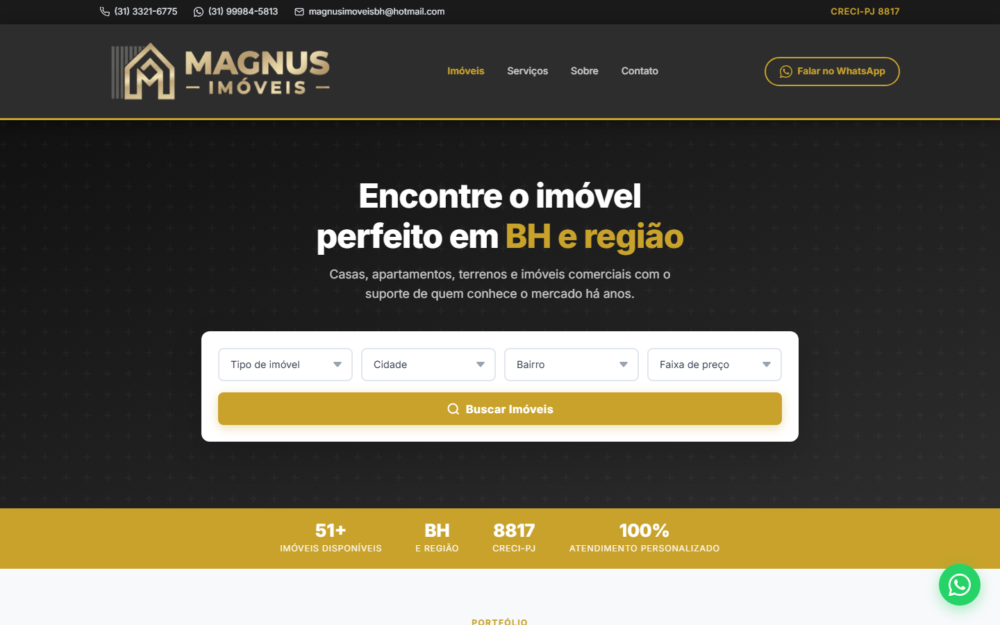
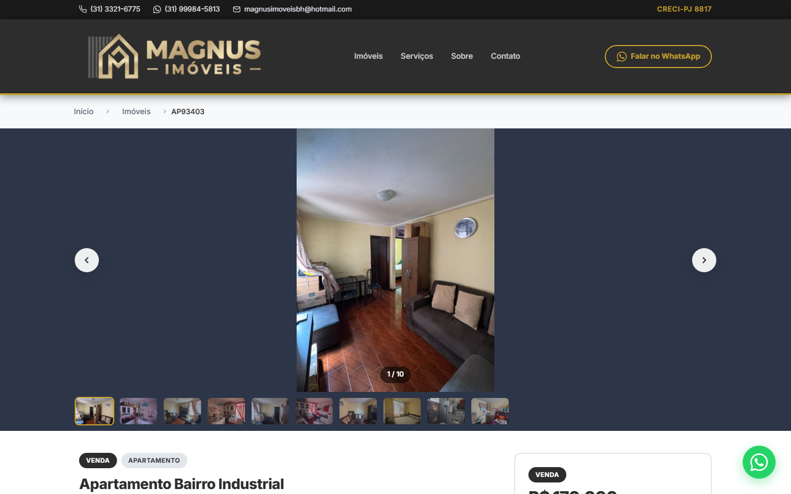
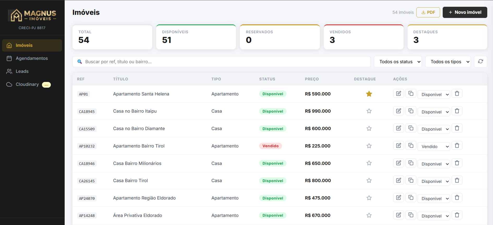
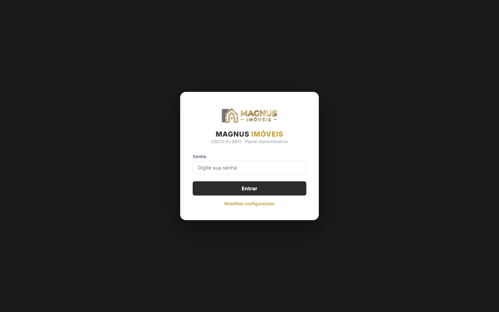
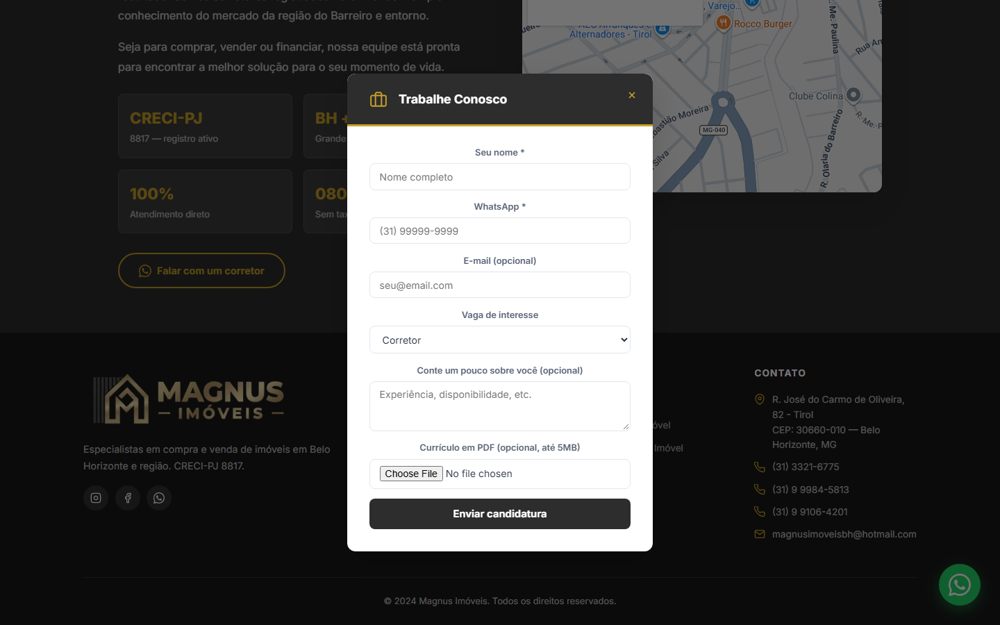

# Magnus Imóveis

**Plataforma completa de captação e gestão de imóveis — do catálogo público ao fechamento do lead.**

## Sobre o projeto

Site e painel administrativo desenvolvidos sob demanda para a Magnus Imóveis, imobiliária de Belo Horizonte (CRECI-PJ 8817). O projeto substituiu uma plataforma de terceiros — paga, com personalização limitada — por um sistema próprio: um site público para busca e divulgação de imóveis, e um painel administrativo completo para a equipe cadastrar, editar e acompanhar cada imóvel e cada lead no dia a dia, sem depender de desenvolvedor para operações rotineiras.

Em produção, com dezenas de imóveis reais cadastrados e leads sendo distribuídos automaticamente entre os corretores por rodízio.

## Prévia

| **Página inicial** | **Detalhes do imóvel** |
|---|---|
|  |  |

| **Painel administrativo** | **Login do admin** |
|---|---|
|  |  |

| **Trabalhe Conosco** | |
|---|---|
|  | |

## Funcionalidades

### Site público
- Busca e filtro de imóveis por tipo, cidade, bairro e faixa de preço
- Página de detalhes com galeria de fotos e vídeo, incluindo lightbox em tela cheia com navegação por teclado e swipe
- Mais de 30 características específicas por tipo de imóvel (ex.: portaria 24h, água aquecida, topografia de terreno), exibidas condicionalmente conforme o tipo cadastrado
- Captura de leads com atribuição automática por rodízio entre corretores
- Agendamento de visita, com criação automática de evento no Google Calendar
- Simulador de financiamento (sistema SAC) integrado ao site
- Formulário "Trabalhe Conosco" com upload de currículo em PDF

### Painel administrativo (PWA instalável)
- CRUD completo de imóveis: cadastro, edição, duplicação e exclusão
- Geração automática de descrição do imóvel por template — sem IA, com concordância gramatical conforme o tipo do imóvel
- Upload de fotos e vídeos via Cloudinary
- Gestão de leads, agendamentos e candidaturas recebidas
- Exportação do catálogo em PDF
- Dashboard com estatísticas (total, disponíveis, reservados, vendidos, destaques)
- Instalável como aplicativo (PWA) em desktop e mobile

### Integrações
- E-mail e Google Calendar via Google Apps Script
- Upload de mídia via Cloudinary
- Google Analytics 4 com eventos customizados (busca, visualização de imóvel, envio de lead)
- Deploy automático via Vercel a cada push

## Arquitetura e stack

| Camada | Tecnologia |
|---|---|
| Frontend | HTML, CSS e JavaScript puro — sem framework ou bundler |
| Dados | Supabase (PostgreSQL via REST API) |
| Mídia | Cloudinary (fotos, vídeos, currículos) |
| Automação / notificações | Google Apps Script (e-mail + Google Calendar) |
| Analytics | Google Analytics 4 |
| Hospedagem | Vercel, com deploy automático a cada push |
| Domínio / DNS | Registro.br |

Quando um visitante demonstra interesse em um imóvel ou se candidata a uma vaga, o formulário grava o registro diretamente no Supabase via REST API, usando uma chave pública protegida por Row Level Security — o acesso anônimo só pode inserir dados, nunca lê-los de volta. Em paralelo, o mesmo payload é enviado a um Google Apps Script, responsável por montar e enviar o e-mail de notificação ao corretor responsável e, em caso de agendamento, criar o evento correspondente no Google Calendar. Se a gravação no Supabase falhar por qualquer motivo, o formulário cai automaticamente em um fallback que abre uma conversa no WhatsApp já com os dados preenchidos — garantindo que nenhum contato se perca.

## Estrutura do projeto

```
magnus-imoveis/
├── index.html             # Página inicial — busca e listagem de imóveis
├── imovel.html             # Página de detalhes de um imóvel
├── admin.html               # Painel administrativo (PWA)
├── admin-manifest.json      # Manifesto PWA do admin
├── admin-sw.js               # Service worker do admin (instalação/offline)
├── apps-script.js             # Código-fonte do Google Apps Script (e-mail + Calendar)
├── css/
│   └── styles.css            # Estilos de todo o site (público + admin)
├── js/
│   ├── dados.js               # Carregamento dos imóveis (Supabase + fallback local)
│   ├── app.js                  # Lógica da página inicial (busca, filtros, grid)
│   ├── imovel.js                # Lógica da página de detalhes (galeria, lightbox, specs)
│   ├── admin.js                  # Lógica completa do painel administrativo
│   ├── leads.js                   # Modais de lead, agendamento e "Trabalhe Conosco"
│   ├── calculadora.js              # Simulador de financiamento (SAC)
│   └── analytics.js                # Eventos customizados do Google Analytics
├── images/                          # Logos e imagens placeholder por tipo de imóvel
├── docs/                             # Documentação comercial e contratual do projeto
└── imoveis.json                       # Fallback local caso o Supabase fique indisponível
```

## Como rodar localmente

Não há build nem dependências de pacote — é um site estático puro, então qualquer servidor HTTP simples resolve.

**Pré-requisitos:**
- Python 3 (ou Node.js, ou a extensão Live Server do VS Code) — só para servir arquivos estáticos
- Acesso a um projeto Supabase (as chaves públicas já estão em `js/dados.js` e `js/leads.js`, apontando para o backend real do projeto)

```bash
git clone <url-do-repositorio>
cd magnus-imoveis
python -m http.server 8000
```

| Serviço | Endereço |
|---|---|
| Site público | http://localhost:8000/index.html |
| Painel administrativo | http://localhost:8000/admin.html |
| Backend (Supabase) | REST API, configurado em `js/dados.js` |
| Mídia (Cloudinary) | Configurado dentro do próprio painel admin, em runtime |

O primeiro acesso ao `admin.html` pede uma configuração inicial (senha de acesso + credenciais do Supabase e Cloudinary), feita uma única vez por navegador.

---

Projeto desenvolvido e mantido sob demanda, com deploy contínuo e evolução orientada pelas necessidades reais da operação da imobiliária.
